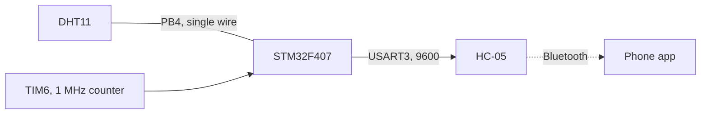

# DHT11 to phone over Bluetooth, without a sensor library

STM32F407 · bit-banged single-wire protocol · HC-05

   [](https://tech-ohm.com)

**English** | [Türkçe](README.tr.md) · An open-source project by [TECH-OHM](https://tech-ohm.com)

Firmware that reads temperature and humidity from a DHT11 and sends them to a phone through an HC-05 Bluetooth module. It uses no ready-made DHT11 library. The single-wire protocol is read by hand with a timer that counts microseconds.

## Block diagram



## Pins

| MCU pin | Connects to | Notes |
|---|---|---|
| PB4 | DHT11 DATA | needs a 4.7k to 10k pull-up, breakout modules already have one |
| PB10 | HC-05 RXD | USART3 TX, 9600 |
| PB11 | HC-05 TXD | USART3 RX |
| PB7 | LED | on while a read is in progress |
| PB14 | LED | toggles on every loop |

## The DHT11 protocol

The sensor talks over one wire, so the pin switches between output and input while running.

1. The MCU holds the line low for 20 ms and releases it. That is the start signal.
2. The sensor answers with 80 µs low and 80 µs high.
3. Then 40 bits follow. Each bit starts with 50 µs low, and the length of the high that follows gives the value: 26 to 28 µs is a 0, about 70 µs is a 1.
4. The 40 bits form five bytes: humidity, humidity decimal, temperature, temperature decimal, checksum.
5. If the fifth byte is not the sum of the first four, the reading is dropped.

TIM6 counts once per microsecond to time all this. `dht_wait_while()` waits as long as the line stays at a given level and returns the elapsed time. If the level does not change within 500 µs the sensor is treated as missing, so the program does not hang when the sensor is unplugged.

## Data sent to the phone

Once a second, as text:

```
humidity|temperature
```

Example: `45|24`. On a failed read it sends `DHT Read Error!!`.

Any Bluetooth serial terminal app shows it. If you write your own app, split the line at the `|` character.

## Build

In STM32CubeIDE use `File > Import > Existing Projects into Workspace` and select this folder. The clock is 84 MHz from the internal oscillator.

## Status

I reworked the bit decoding and the checksum test and have not re-tested with a sensor since.

## License

MIT. The STM32 HAL and CMSIS files under `Drivers` keep their own licenses.

## Author

M. Eyüb Can, embedded systems engineer and founder of [TECH-OHM](https://tech-ohm.com)

## About TECH-OHM

[TECH-OHM](https://tech-ohm.com) designs electronic boards and embedded software, from the first schematic to series production. We also run a 12-month embedded systems training program and consult for engineering teams.

Web: [tech-ohm.com](https://tech-ohm.com) · Email: info@tech-ohm.com
