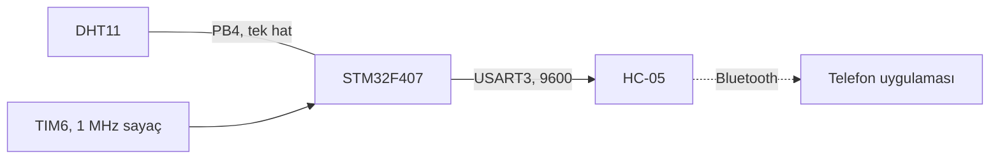

# STM32F407 ile DHT11 okuma ve Bluetooth üzerinden telefona gönderme

[English](README.md) | **Türkçe**

> [TECH-OHM](https://tech-ohm.com) açık kaynak projesi

DHT11 sensöründen sıcaklık ve nem okuyup HC-05 Bluetooth modülü üzerinden telefona gönderen yazılım. DHT11 için hazır kütüphane kullanmadım, tek hat protokolünü mikrosaniye sayan bir timer ile elle okudum.

## Blok diyagram



## Pinler

| Kart pini | Bağlandığı yer | Açıklama |
|---|---|---|
| PB4 | DHT11 DATA | 4.7k ile 10k arası pull-up ister, modül kartlarında üzerinde var |
| PB10 | HC-05 RXD | USART3 TX, 9600 |
| PB11 | HC-05 TXD | USART3 RX |
| PB7 | LED | okuma sürerken yanar |
| PB14 | LED | her döngüde durum değiştirir |

## DHT11 protokolü

Sensörle tek bir hat üzerinden konuşuluyor, o yüzden pin çalışırken giriş ve çıkış arasında değiştiriliyor.

1. İşlemci hattı 20 ms 0'da tutup bırakıyor. Bu başlatma işareti.
2. Sensör 80 µs 0, ardından 80 µs 1 göndererek cevap veriyor.
3. Sonra 40 bit geliyor. Her bit 50 µs 0 ile başlıyor, ardından gelen 1'in süresi bitin değerini veriyor: 26 ile 28 µs ise 0, 70 µs civarı ise 1.
4. 40 bit beş bayta ayrılıyor: nem, nem ondalık, sıcaklık, sıcaklık ondalık, sağlama.
5. Beşinci bayt ilk dördünün toplamına eşit değilse okuma atılıyor.

Süreleri ölçmek için TIM6 mikrosaniyede bir sayacak şekilde ayarlı. `dht_wait_while()` hat aynı seviyede kaldığı sürece bekliyor ve geçen süreyi döndürüyor. 500 µs içinde seviye değişmezse sensör yok sayılıyor, böylece sensör çıkarıldığında program takılmıyor.

## Telefona giden veri

Saniyede bir, metin olarak:

```
nem|sıcaklık
```

Örnek: `45|24`. Okuma başarısızsa `DHT Read Error!!` gidiyor.

Telefon tarafında herhangi bir Bluetooth seri terminal uygulamasıyla görebilirsin. Kendi uygulamanı yazıyorsan satırı `|` işaretinden bölmen yeterli.

## Derleme

STM32CubeIDE'de `File > Import > Existing Projects into Workspace` ile klasörü seç. Saat dahili osilatörden 84 MHz.

## Durum

Bit okuma ve sağlama kontrolünü düzenledikten sonra sensörle yeniden denemedim.

## Lisans

MIT. `Drivers` klasöründeki STM32 HAL ve CMSIS dosyaları kendi lisanslarıyla gelir.

## Yazar

Gömülü Sistem Mühendisi M. Eyüb Can, [TECH-OHM](https://tech-ohm.com) kurucusu

## TECH-OHM

[TECH-OHM](https://tech-ohm.com) elektronik kart ve gömülü yazılım tasarlayan bir mühendislik firması. Fikirden seri üretime kadar tasarım işi alıyor, TECH-OHM Akademi'de 12 aylık gömülü sistem eğitimi ve şirketlere özel danışmanlık veriyor.

Web: [tech-ohm.com](https://tech-ohm.com) · E-posta: info@tech-ohm.com
